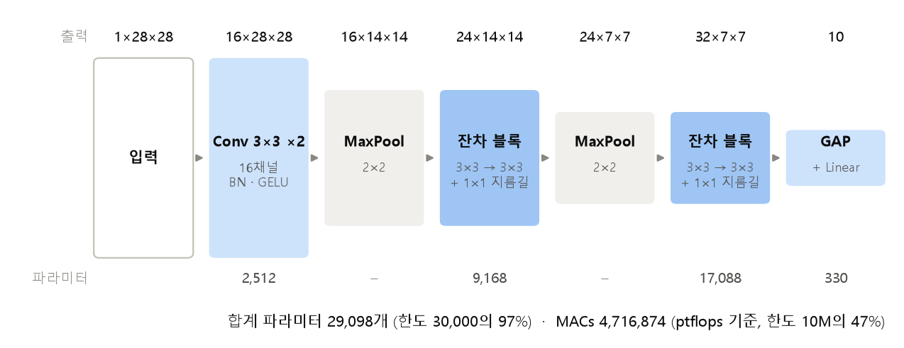
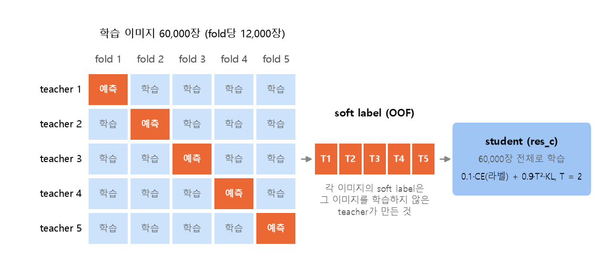
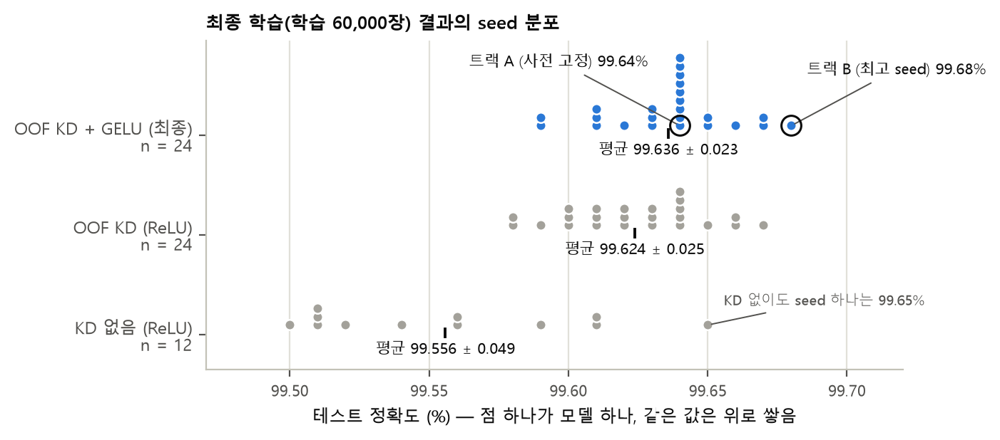
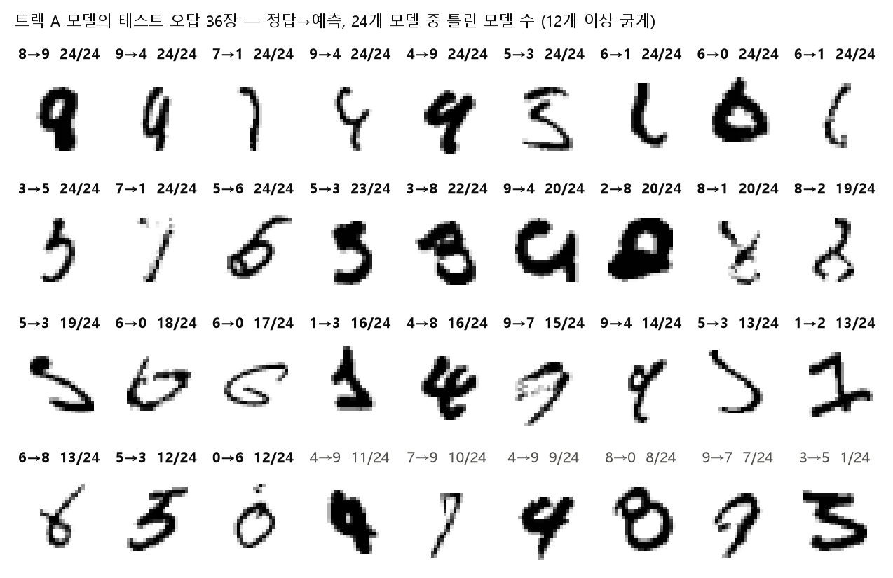
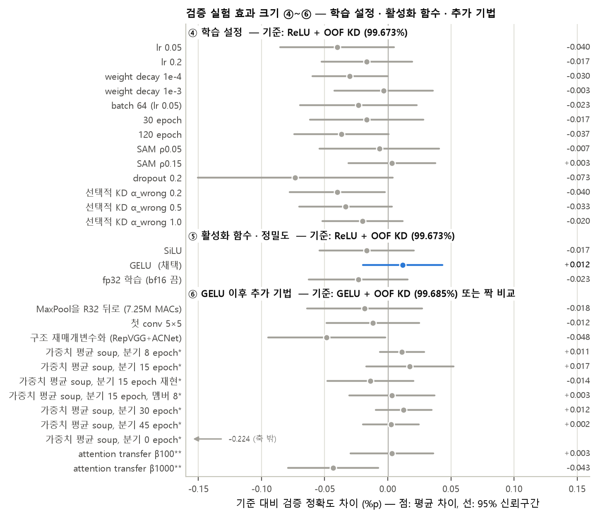

# 딥러닝응용 과제 2 보고서

## CNN 기반 MNIST 숫자 분류기: 파라미터 3만 개·연산량 0.01 GMACs 제한에서 정확도 최대화

- **학번**: 202258096
- **이름**: 임준현
- **제출물**: 본 보고서 1부, 코드 압축파일 1개 (`202258096_임준현_딥러닝응용_과제2코드.zip`)
- **제출일**: 2026년 11월 5일

## 목차

- [1. 개요](#1-개요)
   - [1.1 과제와 조건 준수](#11-과제와-조건-준수)
   - [1.2 결과 요약](#12-결과-요약)
- [2. 접근 전략](#2-접근-전략)
   - [2.1 제약 분석: 병목은 파라미터다](#21-제약-분석-병목은-파라미터다)
   - [2.2 증강 대신 지식 증류](#22-증강-대신-지식-증류)
   - [2.3 평가 원칙과 진행 과정](#23-평가-원칙과-진행-과정)
- [3. 데이터와 실험 환경](#3-데이터와-실험-환경)
   - [3.1 데이터 분할과 전처리](#31-데이터-분할과-전처리)
   - [3.2 테스트셋 격리](#32-테스트셋-격리)
   - [3.3 실험 환경과 동시 학습](#33-실험-환경과-동시-학습)
- [4. 모델 구조 설계안](#4-모델-구조-설계안)
   - [4.1 최종 구조](#41-최종-구조)
   - [4.2 설계 근거](#42-설계-근거)
   - [4.3 구조 탐색](#43-구조-탐색)
- [5. 학습 방법과 하이퍼파라미터](#5-학습-방법과-하이퍼파라미터)
   - [5.1 OOF 지식 증류](#51-oof-지식-증류)
   - [5.2 teacher 모델](#52-teacher-모델)
   - [5.3 학습 하이퍼파라미터](#53-학습-하이퍼파라미터)
- [6. 최종 결과](#6-최종-결과)
   - [6.1 레시피별 테스트 정확도](#61-레시피별-테스트-정확도)
   - [6.2 제출 모델(트랙 A)과 참고 모델(트랙 B)](#62-제출-모델트랙-a과-참고-모델트랙-b)
   - [6.3 오답 분석](#63-오답-분석)
- [7. 검증 실험 요약](#7-검증-실험-요약)
- [8. 노이즈 속에서 개선을 판단한 방법](#8-노이즈-속에서-개선을-판단한-방법)
   - [8.1 판단 원칙](#81-판단-원칙)
   - [8.2 테스트로 고를 때 생기는 착시](#82-테스트로-고를-때-생기는-착시)
   - [8.3 남은 오답의 구성과 개선 여지](#83-남은-오답의-구성과-개선-여지)
- [9. 고찰 및 결론](#9-고찰-및-결론)
   - [9.1 무엇이 정확도를 올렸고, 왜 더 오르지 않았나](#91-무엇이-정확도를-올렸고-왜-더-오르지-않았나)
   - [9.2 한계](#92-한계)
   - [9.3 결론](#93-결론)
- [부록 A. 제출 파일과 실행 방법](#부록-a-제출-파일과-실행-방법)
- [부록 B. 코드 구성](#부록-b-코드-구성)
- [부록 C. 핵심 코드](#부록-c-핵심-코드)

---

<!-- 본문 시작: build_report.py는 이 줄 아래만 docx 본문으로 사용하고, 표지·목차는 따로 생성함 -->

## 1. 개요

### 1.1 과제와 조건 준수

> **과제** CNN을 기반으로 MNIST 분류 정확도를 최대화한다.
>
> **조건 1** 모델 크기 제한 (MACs 0.01 G, Params 0.03 M)
>
> **조건 2** TestDB를 학습 DB에 포함시키지 말 것 (자체 검증 예정, 발각 시 무효 처리)
>
> **조건 3** 학습 DB 증강은 하지 말 것
>
> **제출** 모델 구조 설계안, 학습 하이퍼파라미터, 최종 결과, 리포트(코드 첨부)

세 조건은 다음과 같이 지켰다.

- **조건 1**: 제출 모델은 파라미터 29,098개, MACs 4,716,874로 한도(30,000개, 10,000,000) 안이다. 측정 도구마다 값이 조금씩 달라 thop과 ptflops로 모두 재고 큰 값으로 판정하였다(4.1절, 부록 C.2). 크기 제한은 제출(추론) 모델에 적용된다고 보았으며, 학습에만 쓰는 teacher(파라미터 2,776,522개)는 제출 모델에 포함되지 않고 추론에도 쓰이지 않는다.
- **조건 2**: 테스트 10,000장은 학습에 쓰지 않았고, 구조나 하이퍼파라미터를 고르는 데에도 쓰지 않았다. 개발 단계의 모든 결정은 학습 60,000장에서 떼어 낸 검증용 5,000장으로 내렸고, 제출 모델(트랙 A)은 최종 학습 전에 미리 지정하였다(3.2절, 6.2절, 부록 C.5).
- **조건 3**: 제출 모델을 만드는 과정과 이 보고서의 모든 실험에서, 학습 이미지를 변형하거나 늘리는 증강을 student(제출 모델)와 teacher 모두에 쓰지 않았다. 추론할 때 변형한 이미지를 함께 넣는 방식(TTA)도 쓰지 않았다(3.1절, 표 6).

각 제출 요구사항은 다음 위치에서 다룬다. **모델 구조 설계안**: 4장(그림 1, 표 3·4) · **학습 하이퍼파라미터**: 5.3절(표 6) · **최종 결과**: 1.2절(표 1)과 6장(표 7) · **코드**: 부록 A~C와 코드 압축파일(`202258096_임준현_딥러닝응용_과제2코드.zip`).

### 1.2 결과 요약

- 정확도를 가장 크게 좌우한 것은 구조가 아니라 **학습 목표**였다. 같은 모델의 테스트 정확도는 라벨만으로 학습하면 99.556 ± 0.049%(ReLU), OOF 지식 증류를 쓰면 99.624 ± 0.025%, 여기에 활성화 함수를 GELU로 바꾸면 99.636 ± 0.023%이다.
- 핵심은 **OOF**이다. 각 학습 이미지의 soft label을 그 이미지를 학습하지 않은 teacher가 만들게 하자 검증 정확도가 +0.077%p 올랐다. 그 이미지를 학습한 teacher의 soft label로는 +0.017%p에 그쳤다.
- 구조, 하이퍼파라미터, teacher 종류, 가중치 평균, attention transfer 등 dev 학습 작업 70개를 대부분 seed 6개 이상으로 비교했지만, OOF KD 기준보다 뚜렷이 나은 설정은 없었다(4.3절, 5.2절, 7장).
- 남은 오답의 약 3/4은 큰 teacher 앙상블도 함께 틀리는 모호한 글씨여서(검증셋 기준), 이 제약에서 학습 방법만으로 더 줄일 여지는 작다(8.3절).

**표 1.** 최종 결과 요약 (제출 모델은 트랙 A)

| 항목 | 내용 |
|--------------------------|--------------------------------------------------------------------------|
| 구조 | 잔차 CNN `res_c`: Conv(16) → Conv(16) → MaxPool → 잔차 블록(24) → MaxPool → 잔차 블록(32) → GAP(전역 평균 풀링) → Linear(10), 활성화 함수 GELU |
| 크기 | 파라미터 **29,098개** (한도 30,000의 97.0%), MACs **4,716,874** (ptflops 기준, 한도 10,000,000의 47.2%) |
| 학습 방법 | 5-fold out-of-fold(OOF) 지식 증류(KD): 큰 teacher 5개가 만든 soft label 사용, 증강 없음 |
| 학습 설정 | SGD(Nesterov) lr 0.1, batch 128, 60 epoch, one-cycle 학습률, EMA(가중치 지수이동평균) 0.999, KD α 0.9·T 2 |
| **트랙 A** (사전 고정, 제출) | **테스트 정확도 99.64%** (오답 36장) |
| 트랙 B (24개 중 테스트 최고, 참고) | 테스트 정확도 99.68% (오답 32장) |
| 같은 레시피 24개 평균 | 테스트 정확도 99.636 ± 0.023% (99.59 ~ 99.68%) |

## 2. 접근 전략

### 2.1 제약 분석: 병목은 파라미터다

3×3 합성곱 한 층(입력 채널 $C_{in}$, 출력 채널 $C_{out}$, 특징맵 크기 $H \times W$)의 파라미터는 $9C_{in}C_{out}$이고 MACs는 $9C_{in}C_{out}HW$이다. 즉 파라미터 하나가 28×28 해상도에서는 곱셈-누적을 784번, 14×14에서는 196번, 7×7에서는 49번 수행한다. 파라미터 3만 개를 모두 28×28 층에 두면 약 2,352만 MACs로 한도의 2.4배가 되지만, 14×14에 두면 약 588만, 7×7에 두면 약 147만 MACs이다. 따라서 고해상도 층을 얇게 두면 연산 한도는 자연스럽게 지켜지고, 실제로 모델 용량을 묶는 것은 **파라미터 한도**가 된다. 최종 모델도 파라미터는 한도의 97%를 쓰지만 MACs는 47%만 쓴다. 남는 연산 예산을 쓰는 구조도 시험했지만 이득이 없었다(4.3절).

### 2.2 증강 대신 지식 증류

데이터 증강이 금지되어 있으므로, 입력이 아니라 **학습 목표**를 바꾸는 지식 증류(knowledge distillation, KD)를 핵심 수단으로 삼았다. 크기 제한이 없는 큰 teacher를 먼저 학습하고, student(제출 모델)는 정답 라벨과 함께 teacher의 출력 확률 분포(soft label)도 따라 하도록 학습한다. soft label은 "이 4는 9와 조금 닮았다" 같은 클래스 간 유사도 정보를 담고 있고, 라벨이 잘못 붙은 이미지에서는 다른 클래스를 가리키므로 라벨 잡음도 줄여 준다. 다만 teacher가 학습한 이미지에 대한 예측은 사실상 라벨을 외운 값이다(학습 이미지에서 라벨과 100.000% 일치). 그래서 각 이미지의 soft label을 **그 이미지를 학습하지 않은 teacher**가 만들도록 5-fold out-of-fold(OOF) 방식을 썼다(5.1절).

### 2.3 평가 원칙과 진행 과정

설정 사이의 정확도 차이는 대부분 0.01~0.05%p이다. 테스트 10,000장에서 0.01%p는 이미지 1장이고, 같은 설정을 seed만 바꿔 다시 학습해도 테스트 정확도가 표준편차 0.023%p(약 2.3장)만큼 흔들린다. 테스트 점수로 설정을 고르면 실력이 아니라 운을 고르게 되므로, **모든 설계 결정은 학습 데이터에서 떼어 낸 검증셋 5,000장으로 내리고 각 설정은 seed 6개 이상의 평균으로 평가**하였다. 최종 결과는 두 트랙으로 보고한다. **트랙 A**(주 결과)는 최종 학습 전에 미리 지정해 둔 모델(첫 번째 작업의 첫 번째 모델, `j0_s0`)이고, **트랙 B**(참고)는 같은 레시피 24개 중 테스트 정확도가 가장 높은 모델이다. 트랙 B는 테스트셋으로 고른 결과라 선택 편향이 있다(6.2절, 8.2절).

진행 과정을 논리적 순서로 정리하면 다음과 같다.

1. **구조 탐색 (KD 없음)**: VGG형, 잔차형, depthwise 분리형, 가중치 공유형 등 14가지 구조를 비교하였다(4.3절).
2. **지식 증류 도입**: 같은 이미지를 학습한 teacher로는 효과가 없었고, OOF teacher로 바꾸자 검증 정확도가 99.597%에서 99.673%로 올랐다(5.1절).
3. **KD 적용 후 재탐색**: teacher 종류, 구조, 학습률·weight decay·epoch·SAM(평탄한 최솟값을 찾는 최적화 기법) 등을 다시 비교했지만 기준보다 뚜렷이 나은 설정은 없었다(4.3절, 5.2절, 7장).
4. **1차 최종 학습 (ReLU)**: 학습 60,000장 전체로 모델 24개를 학습하였다(테스트 99.624 ± 0.025%).
5. **활성화 함수 비교**: GELU가 두 번의 독립 반복에서 모두 ReLU보다 높아 채택하고, GELU로 24개를 다시 학습하였다(최종, 99.636 ± 0.023%).
6. **마지막 라운드**: 가중치 평균(soup)은 재현에 실패하여 기각하였고, attention transfer와 구조 재매개변수화는 결과를 보기 전에 정해 둔 채택 기준에 못 미쳤다. 이 단계에서 실험을 마쳤다(8.1절).

실제로는 4단계를 3단계 도중에 실행했기 때문에, 1차 최종 학습의 테스트 결과는 3단계의 일부 실험과 5·6단계보다 먼저 나와 있었다. 이 실험들의 판단은 모두 검증셋으로 내렸고, 그 결과 레시피에서 바뀐 것은 활성화 함수(GELU)뿐이다. 실제 실행 순서와 시각은 `results/logs/_daemon.log`에 있다.

## 3. 데이터와 실험 환경

### 3.1 데이터 분할과 전처리

데이터는 표 2와 같이 나누어 썼다.

**표 2.** 데이터 분할

| 용도 | 구성 | 장수 | 쓰임 |
|------------------|------------------------------------------------|---------:|------------------------------|
| 개발용 학습 (dev) | 학습 60,000장 중 검증용을 뺀 나머지 | 55,000 | 구조·하이퍼파라미터 탐색 |
| 검증 (val) | 학습 60,000장 중 고정 seed(12345)로 무작위 추출 | 5,000 | 모든 설계 결정 |
| 최종 학습 (full) | 학습 60,000장 전체 | 60,000 | 최종 모델 학습 |
| 테스트 (test) | MNIST 테스트셋 | 10,000 | 최종 결과 보고에만 사용 |

전처리는 픽셀 값을 255로 나눈 뒤 MNIST 학습셋의 평균·표준편차 상수를 써서 $(x - 0.1307)/0.3081$로 정규화한 것뿐이다. 28×28 흑백 원본을 그대로 쓰고 크기 변경·자르기·증강은 하지 않았으며, 데이터 전체를 GPU 메모리에 올려 매 epoch 무작위 순서로 섞어 사용하였다.

**학습 기록의 `aug` 항목.** 초기 학습 코드(teacher용 `train.py`, student용 `train_packed.py`)에는 기본값이 꺼진 증강 옵션이 있었다. 그래서 그 시기의 기록 275개(student 258개, teacher 17개)의 `args`에는 `"aug": false`가 남아 있고, teacher 기록에는 쓰이지 않은 증강 인자(`aug_rot` 등)도 남아 있다. 이 보고서와 코드 압축파일의 기록 중 `aug: true`인 것은 없으며, 증강 코드는 이후 삭제하였다. 그 뒤에 학습한 기록(최종 GELU 모델 24개를 포함한 student 312개, teacher 5개)에는 이 항목이 없다.

### 3.2 테스트셋 격리

조건 2를 지키기 위해 코드 수준에서 다음을 보장하였다.

- `common.load_mnist()`는 학습 배열과 테스트 배열을 따로 반환하고, 학습 루프는 학습 배열에서만 미니배치를 뽑는다. KD의 soft label과 OOF fold 분할도 학습 이미지에 대해서만 만든다(부록 C.3·C.5).
- 개발 단계(dev split)의 학습 527개(teacher 포함)에서는 **테스트 정확도를 아예 계산하지 않도록** 코드를 작성하였다. 실제로 `results/runs/`의 dev 기록 527개 중 테스트 정확도가 들어 있는 기록은 하나도 없다.
- 테스트 정확도는 최종 학습(full split) 65개(student 60개, teacher 5개)에서만 기록용으로 계산하였다. 최종 student 학습에 붙인 `--test-every-epoch` 옵션은 매 epoch 테스트 정확도를 기록만 하며, 이 값은 8.2절 표 9에서 '테스트로 epoch을 골랐다면' 생기는 차이를 계산하는 데에만 썼다. 최종 모델은 항상 **60 epoch이 끝난 시점의 EMA 가중치**이며, 테스트 정확도를 보고 epoch을 고르거나 학습을 일찍 멈추지 않았다. 테스트로 모델을 고른 것은 참고용인 트랙 B뿐이다.
- 추론은 이미지 한 장을 모델에 한 번 통과시키는 일반적인 방식이며, BN(배치 정규화)은 학습 데이터로 구한 통계를 그대로 쓴다.

### 3.3 실험 환경과 동시 학습

실험 환경은 WSL2(Ubuntu 24.04.3), NVIDIA GeForce RTX 3070 Ti(8GB), Python 3.11.14, PyTorch 2.14.0(CUDA 13.0), thop 0.1.1, ptflops 0.7.5이다.

모델이 매우 작아 하나씩 학습하면 GPU를 거의 쓰지 못하므로, **같은 구조의 독립 모델 K개(보통 6개)를 grouped convolution으로 한 네트워크에 묶어 동시에 학습**하였다(`packed.py`). 이 실행 단위를 '작업'이라고 부르며, `j0_s0`은 0번 작업의 0번 모델이다. 모델마다 초기값, 미니배치 순서, BN 통계, 손실이 모두 따로이므로 학습은 모델별로 독립이다. 구조 9가지에서 묶은 모델과 거기서 꺼낸 단일 모델의 출력을 비교하니 차이가 2.4×10⁻⁷ 이하였다(평가 모드). 최종 학습 기준으로 모델 6개를 약 5분 30초(모델당 약 55초)에 학습했으며, 이 보고서에 실은 실험은 student 570개(작업 80개)와 teacher 22개로 GPU 학습 시간을 모두 합하면 약 9.3시간이다.

## 4. 모델 구조 설계안

### 4.1 최종 구조

{width=100%}

**그림 1.** 최종 모델 `res_c`의 구조. 상자 높이는 특징맵의 공간 크기(28 → 14 → 7)를 나타낸다.

잔차 블록은 3×3 합성곱 두 개와 지름길(shortcut)로 이루어진다. 블록마다 채널 수가 바뀌므로 지름길에는 1×1 합성곱 + BN을 둔다.

$$\mathrm{Res}(x) = \mathrm{GELU}\Big(\mathrm{BN}\big(W_2 * \mathrm{GELU}(\mathrm{BN}(W_1 * x))\big) + \mathrm{BN}(W_s * x)\Big)$$

($W_1, W_2$: 3×3 합성곱 가중치, $W_s$: 1×1 지름길 합성곱 가중치, $*$: 합성곱, BN: 배치 정규화)

**표 3.** 층별 구조 (토큰은 코드 `models.py`의 구조 표기, MACs는 conv·linear의 곱셈-누적 횟수, 배치 1 기준)

| 토큰 | 층 | 출력 크기 | 파라미터 | MACs |
|---------|----------------------------------------|--------------:|------------:|-------------:|
| c3_16 | Conv 3×3 + BN + GELU | 16×28×28 | 176 | 112,896 |
| c3_16 | Conv 3×3 + BN + GELU | 16×28×28 | 2,336 | 1,806,336 |
| M | MaxPool 2×2 | 16×14×14 | 0 | – |
| R24 | 잔차 블록 (3×3, 3×3, 1×1 지름길) | 24×14×14 | 9,168 | 1,768,704 |
| M | MaxPool 2×2 | 24×7×7 | 0 | – |
| R32 | 잔차 블록 (3×3, 3×3, 1×1 지름길) | 32×7×7 | 17,088 | 827,904 |
| G | 전역 평균 풀링 (GAP) | 32 | 0 | – |
| L10 | Linear 32→10 | 10 | 330 | 320 |
|  | **합계** |  | **29,098** | **4,516,160** |

합성곱 층에는 bias를 두지 않고 바로 뒤에 BN을 두었다. MACs는 thop과 ptflops 두 도구로 재고 큰 값으로 판정하였다(코드는 부록 C.2). 측정값은 thop 4,693,376, ptflops 4,716,874로, conv·linear만 센 값(4,516,160)보다 BN·활성화·풀링 연산만큼 크며, 큰 값을 기준으로 해도 한도의 47%이다. 파라미터는 직접 합산, thop, ptflops 모두 29,098개이고, 제출한 두 체크포인트를 `evaluate.py`로 다시 불러 측정해도 같은 값이 나온다.

### 4.2 설계 근거

1. **파라미터는 낮은 해상도에, 연산은 높은 해상도에.** 파라미터의 59%가 7×7 단계(잔차 블록 32)에 있지만 연산은 18%뿐이고, 28×28 단계(첫 두 합성곱)는 파라미터 9%로 연산의 42%를 쓴다(14×14 단계는 파라미터 32%, 연산 39%). 첫 두 층을 16채널로 얇게 두어 28×28에서의 연산을 억제하고, 아낀 예산을 낮은 해상도의 넓은 채널에 썼다.
2. **잔차 블록.** 같은 파라미터로 층을 깊게 쌓아도 학습이 안정적이라 기본 블록으로 택했다(구조 비교와 최종 선택 근거는 4.3절).
3. **GAP + Linear 분류기.** 마지막 특징맵(32×7×7)을 펼쳐 Linear에 넣으면 그 층에만 파라미터 15,690개가 필요하지만, 전역 평균 풀링을 쓰면 330개로 충분하다. 아낀 파라미터는 합성곱 층에 썼다. 공간 정보를 조금 남기는 2×2 평균 풀링 head도 시험했지만 이득이 없었다.
4. **BN과 GELU.** 모든 합성곱 뒤에 BN을 두었다. 활성화 함수는 ReLU, SiLU, GELU를 비교하여 GELU를 택했다(7장).

### 4.3 구조 탐색

**표 4.** 구조 탐색 (대표 구조, ReLU. 검증 정확도(%)는 seed 6개 평균이며 Res-c + OOF KD만 seed 12개 평균, seed 간 표준편차는 0.03~0.07%p. KD 없음 열은 label smoothing 0.1로 학습). 굵은 행이 최종 구조이다.

| 구조 | 토큰 표기 | 파라미터 | MACs | KD 없음 | OOF KD |
|---------|---------------------------------------------------|---------:|-------:|---------:|-----------:|
| VGG-a | `c3_16 c3_24 M c3_32 c3_48 M c1_64 G L10` | 28,426 | 7.30M | 99.567 | – |
| VGG-g | `c3_16 c3_16 M c3_24 c3_32 M c3_32 c3_24 G L10` | 29,482 | 4.94M | 99.583 | – |
| Res-a | `c3_16 M R24 M R32 c1_64 G L10` | 29,258 | 2.98M | 99.610 | – |
| **Res-c** | `c3_16 c3_16 M R24 M R32 G L10` | **29,098** | **4.72M** | **99.600** | **99.673** |
| DS-a | `c3_16 ds3_32 M ds3_48 ds3_64 M ds3_96 ds3_96 G L10` | 25,114 | 3.00M | 99.650 | 99.670 |
| DS-k | `c3_16 ds3_32 M ds3_48 ds3_64 M ds3_104 ds3_104 G L10` | 27,426 | 3.11M | – | 99.683 |
| 공유-a3 | `c3_16 M c3_24 RS24x3 M c3_48 c1_64 G L10` | 28,650 | 7.79M | 99.603 | – |
| 공유-c | `c3_12 M c3_24 M c3_32 RS32x4 G L10` | 29,022 | 4.69M | 99.523 | – |

`c1_64`는 1×1 합성곱 64채널, `ds3_32`는 3×3 depthwise + 1×1 pointwise 32채널, `RS24x3`은 같은 가중치를 3번 반복하는 24채널 잔차 블록(BN은 반복마다 따로)이며, '공유'는 가중치 공유형이다. 시험한 14개 구조와 KD 적용 후 변형 7개의 전체 결과(표준편차 포함)는 코드 압축파일의 `results/report/tables.md`에 있다.

- KD 없이는 14개 구조가 99.497~99.650%에 분포했다. seed 6개 평균의 표준오차가 약 0.014~0.036%p라서 대부분의 차이는 seed 노이즈와 구분되지 않는다. 남는 연산 예산을 쓰려고 같은 블록을 3~6번 반복한 가중치 공유형은 MACs를 최대 9.6M까지 써도 이득이 없었다.
- KD 없이는 depthwise 분리형 DS-a가 가장 높았지만, KD를 적용하자 비교한 변형 7개(depthwise형 6개, 2×2 head를 단 Res-c 변형 1개)가 모두 기준 대비 −0.013 ~ +0.010%p 안에 들었다. 그래서 학습 시간이 depthwise형의 약 절반이고 가장 많은 실험으로 검증한 Res-c를 최종 구조로 유지하였다. GELU를 적용한 뒤 시험한 두 변형(두 번째 MaxPool을 R32 뒤로 옮겨 R32를 14×14에서 계산, 첫 합성곱을 5×5로 확대)도 각각 −0.018, −0.012%p로 차이가 없었다(그림 5 ⑥).

## 5. 학습 방법과 하이퍼파라미터

### 5.1 OOF 지식 증류

{width=94%}

**그림 2.** 5-fold out-of-fold 지식 증류. teacher k는 fold k를 뺀 48,000장으로 학습하고 fold k(12,000장)를 예측한다. 다섯 teacher의 예측을 모으면 60,000장 모두에 대해 "그 이미지를 학습하지 않은 teacher"의 soft label이 생긴다.

student의 손실 함수는 다음과 같다($z_s$: student logit, $z_t$: OOF teacher logit, $y$: 정답 라벨).

$$\mathcal{L} = (1-\alpha)\,\mathrm{CE}\big(y,\ \mathrm{softmax}(z_s)\big) + \alpha\,T^2\,\mathrm{KL}\big(\mathrm{softmax}(z_t/T)\ \big\|\ \mathrm{softmax}(z_s/T)\big),\qquad \alpha = 0.9,\ T = 2$$

α는 soft label 항의 비중이고 $T$는 온도이다. $T^2$는 온도 $T$로 나눈 분포의 gradient가 $1/T^2$배로 작아지는 것을 보정하는 표준적인 배율이다. fold는 학습 60,000장을 고정 seed(777)로 섞어 12,000장씩 나누었고(그림 2), teacher는 40 epoch 학습한 뒤 빠진 fold의 logit을 저장한다. 다섯 fold를 합치면 60,000장이 각각 정확히 한 번씩 덮인다(코드로 확인). student는 60,000장 전체를 위 손실로 학습하며, teacher는 학습에만 쓰이고 제출 모델에는 포함되지 않는다.

**표 5.** teacher를 만드는 방식에 따른 효과 (ReLU student, α 0.9·T 2. 검증 정확도는 seed 6개 평균 ± 표준편차이며 OOF만 seed 12개, 괄호 안은 '없음' 대비 차이 %p)

| teacher | 학습 이미지에서 teacher 예측과 라벨의 일치율 | student 검증 정확도 (%) |
|--------------------------------------|:------------------------------:|:--------------------------------:|
| 없음 (라벨만 학습) | – | 99.597 ± 0.034 |
| in-sample (55,000장 전체로 학습) | 100.000% | 99.613 ± 0.039 (+0.017) |
| OOF (5-fold) | 99.582% | **99.673 ± 0.037 (+0.077)** |

표 5에서 보듯 in-sample teacher는 자기가 학습한 이미지의 라벨을 하나도 빠짐없이 외우기 때문에, 그 soft label은 라벨과 거의 같은 정보만 준다. OOF teacher는 처음 보는 이미지에 대한 정직한 예측을 주므로 클래스 간 유사도를 담고 있고, 라벨과 다르게 판단하는 경우(dev split 기준 0.42%)도 있다.

**라벨 정제 효과.** 최종 학습에 쓴 OOF teacher는 학습 60,000장 중 246장(0.41%)에서 라벨과 다른 클래스를 예측하며, 그중에는 라벨이 틀렸거나 사람이 봐도 애매한 글씨가 많다(예시는 코드 압축파일의 `results/figures/fig_val_hard.png` (b)). 학습을 마친 모델이 이 246장을 어떻게 예측하는지 세어 보면, 라벨만으로 학습한 모델(ReLU, 12개 평균)은 241.8장에서 라벨을 따르지만, OOF KD student(GELU, 24개 평균)는 213.8장(약 87%)에서 teacher의 판단을 따른다(트랙 A 모델은 207장). 즉 KD는 의심스러운 라벨을 자동으로 고쳐 주는 역할도 한다. teacher와 라벨이 다른 이미지에서만 α를 바꾼 '선택적 KD'(α_wrong 0.2·0.5·1.0)도 시험했지만 모두 기준보다 높지 않았고, 라벨 쪽 비중을 높인 경우(α_wrong 0.2·0.5: −0.040·−0.033%p)가 가장 낮았다(그림 5 ④). 적어도 teacher의 판단을 라벨 쪽으로 되돌리는 것은 도움이 되지 않았다.

**온도와 가중치.** T = 2가 가장 좋았고(T = 1, 2, 3, 4에서 각각 99.640, 99.673, 99.643, 99.593%), T = 4에서는 OOF teacher로도 효과가 사라졌다. α는 0.9가 0.5(99.657%), 1.0(99.650%)보다 조금 높았다. in-sample teacher는 α·T와 관계없이 효과가 거의 없었다(+0.007 ~ +0.017%p).

### 5.2 teacher 모델

teacher `t_res`는 `c3_64 R64 R64 M R128 R128 M R256 R256 G D0.3 L10`(잔차 블록 6개, 분류기 앞 dropout 0.3, ReLU) 구조로, 파라미터 2,776,522개(student의 95배), MACs 약 3.23억이다. fold 하나를 학습하는 데 약 3.2분이 걸렸다(학습 설정은 표 6). 개발 단계의 fold teacher(44,000장 학습)는 검증 정확도 99.58~99.70%(평균 99.616%), 최종 fold teacher(48,000장 학습)는 테스트 정확도 99.63~99.74%(평균 99.690%)이다. teacher 정확도는 참고용이며 제출 모델과는 무관하다.

다른 teacher도 시험하였다. 넓은 VGG형 teacher(`t_wide`, 파라미터 2,580,202개)의 OOF soft label로 학습한 student는 99.570%로, 기준보다 0.103%p 낮았고 KD를 쓰지 않은 경우(99.597%)보다도 낮았다. 두 teacher의 logit 평균(−0.007%p)이나 fold 분할이 다른 OOF 세트 두 개의 평균(+0.000%p)도 이득이 없었다. OOF로 만드는 것이 가장 중요했지만 충분조건은 아니었다.

### 5.3 학습 하이퍼파라미터

**표 6.** 학습 하이퍼파라미터

| 항목 | student (제출 모델) | teacher (`t_res`, fold별) |
|----------------------|--------------------------------------------------------------|----------------------------------|
| 학습 데이터 | 학습 60,000장 전체, 증강 없음 | fold당 48,000장 (분할 seed 777), 증강 없음 |
| 옵티마이저 | SGD, momentum 0.9, Nesterov | 같음 |
| 학습률 | 최대 0.1, one-cycle: 처음 15% step 동안 0 → 0.1 선형 증가, 이후 cosine으로 1×10⁻⁴까지 감소 | 같음 |
| weight decay | 5×10⁻⁴ (conv·linear 가중치에만 적용, BN·bias 제외) | 같음 |
| batch size, epoch | 128, 60 epoch (epoch당 468 step, 총 28,080 step) | 128, 40 epoch |
| 손실 | 0.1·CE + 0.9·T²·KL (T = 2), label smoothing 없음 | CE, label smoothing 없음 |
| soft label | 5-fold OOF teacher logit (`t_res_full_oof5`) | – |
| EMA | decay 0.999 (초반에는 min(0.999, (1+n)/(10+n))로 짧게 평균) | 같음 |
| 최종 가중치 | 60 epoch 종료 시점의 EMA 가중치 (epoch 선택 없음) | 40 epoch 종료 시점의 EMA 가중치로 logit 저장 |
| dropout | 없음 | 0.3 (분류기 앞) |
| 정밀도 | 학습 bf16 autocast, 평가 fp32 (학습 중 GPU 평가는 TF32 합성곱 허용, 제출 모델은 CPU fp32로 다시 평가해도 같음) | 학습 bf16 |
| 초기화, 데이터 순서 | PyTorch 기본값, 매 epoch 모델별 무작위 셔플 | PyTorch 기본값, 매 epoch 무작위 셔플 |
| seed | 트랙 A: `--seed 11` 작업(`j0`)의 0번 모델, 트랙 B: `--seed 1011` 작업(`j1`)의 3번 모델 | fold 번호 |

학습률, weight decay, batch, epoch을 기준값 주변에서 바꿔 보았지만 기준보다 뚜렷이 나은 값은 없었고, 120 epoch은 오히려 낮았다(−0.037%p, 그림 5 ④). EMA와 BN 통계 재추정은 결과를 거의 바꾸지 않았다(GELU 검증 기준: 일반 가중치 99.683%, EMA 99.685%, EMA 후 BN 재추정 99.687%). dev split의 학습 곡선(GELU)을 보면 KD 모델의 검증 정확도는 마지막 10 epoch 동안 거의 평탄했다. KD 없는 모델은 42 epoch 무렵 99.617%까지 올랐다가 99.570%로 끝났다. 학습률도 cosine으로 거의 0까지 줄어들므로 마지막 epoch의 EMA 가중치를 그대로 써도 무리가 없다(학습 곡선 그림은 코드 압축파일의 `results/figures/fig_val_curves.png`).

## 6. 최종 결과

### 6.1 레시피별 테스트 정확도

**표 7.** 최종 학습(학습 60,000장) 결과: 테스트 정확도 (%, 표준편차는 seed 간 표본 표준편차, KD 없음은 label smoothing 0.1)

| 레시피 | seed | 평균 ± 표준편차 | 최소 – 최대 | 사전 고정 모델 | 최고 seed |
|----------------------------|:-------:|:------------------:|:----------------:|:----------------:|:---------------:|
| KD 없음 (ReLU) | 12 | 99.556 ± 0.049 | 99.50 – 99.65 | 99.65 | 99.65 |
| OOF KD (ReLU) | 24 | 99.624 ± 0.025 | 99.58 – 99.67 | 99.62 | 99.67 |
| **OOF KD (GELU), 최종** | 24 | **99.636 ± 0.023** | 99.59 – 99.68 | **99.64 (트랙 A)** | **99.68 (트랙 B)** |

- OOF KD는 같은 구조를 라벨만으로 학습한 경우보다 평균 +0.068%p(ReLU 기준) 높고(그림 3), seed 간 표준편차도 0.049%p에서 0.025%p로 절반이 되었다. KD 없음의 사전 고정 모델(99.65%)이 트랙 A(99.64%)보다 높은 것은 seed 운이며, 평균으로는 최종 레시피가 0.08%p 높다(8.2절). KD 없는 레시피에는 label smoothing 0.1을 썼는데, 검증에서 label smoothing 0과 0.1은 차이가 없었다(99.597 대 99.600%).
- GELU는 ReLU보다 평균 +0.012%p 높았다. 검증에서 본 차이(+0.012%p)와 방향·크기가 같지만, 이 차이의 95% 신뢰구간(약 −0.001 ~ +0.026%p)은 0을 포함한다.
- 참고로 최종 fold teacher(파라미터 95배, 48,000장 학습)의 테스트 정확도 평균은 99.690%로, student와의 차이는 0.054%p이다.

{width=92%}

**그림 3.** 최종 학습 결과의 seed 분포. 점 하나가 모델 하나이고, 같은 값은 위로 쌓았다.

### 6.2 제출 모델(트랙 A)과 참고 모델(트랙 B)

- **트랙 A (주 결과)**: `fin_oof_res_c_gelu_j0_s0`, **테스트 정확도 99.64%**(10,000장 중 오답 36장). 최종 학습을 시작하기 전에 "각 레시피의 `j0_s0`을 제출 모델로 한다"고 정해 두었다(`final_report.py` 머리말, `jobs/queue.txt`의 최종 학습 명령 위 주석 "트랙A=사전고정 j0_s0"). 같은 레시피 24개 모델의 평균(99.636%)과 거의 같아, 이 레시피의 성능을 대표하는 결과로 볼 수 있다.
- **트랙 B (참고)**: `fin_oof_res_c_gelu_j1_s3`, **테스트 정확도 99.68%**(오답 32장). 트랙 A와 레시피·크기가 같고 seed(초기값과 데이터 순서)만 다르다. 24개 중 테스트 정확도로 고른 값이므로 그대로 기대 성능으로 볼 수는 없다. 같은 분포에서 24개를 뽑으면 최댓값의 기댓값은 평균 + 약 1.95σ인데, 99.636 + 1.95 × 0.023 ≈ 99.68%로 트랙 B의 점수와 같다. 즉 트랙 B의 점수는 seed 운만으로 설명되며, 새 데이터에서 기대할 수 있는 정확도는 24개 모델의 평균(99.636%) 안팎이다.
- 두 모델의 오답 중 27장이 같다. 오답 수 차이(4장)는 두 모델 차이의 표준편차(√2 × 2.3 ≈ 3.2장) 안팎이다.

### 6.3 오답 분석

트랙 A 모델은 숫자 5(99.33%), 6(99.37%), 9(99.41%)에서 상대적으로 약하다. 자주 틀리는 쌍은 5를 3으로(5장), 9를 4로(4장), 6을 0으로(3장), 4를 9로(3장) 본 경우이다(클래스별 정확도 전체는 `results/report/tables.md`).

{width=88%}

**그림 4.** 트랙 A 모델의 테스트 오답 36장. 각 이미지 위의 표기는 정답→예측과, 같은 레시피 24개 모델 중 그 이미지를 틀린 모델 수이다(12개 이상이 틀린 이미지는 굵게 표시).

그림 4의 36장 중 30장은 24개 모델 중 절반 이상이 함께 틀렸고, 12장은 24개 모두가 틀렸다. 트랙 A 모델만 틀린 이미지는 1장뿐이다. 위가 열려 4처럼 보이는 9, 고리가 작거나 끊겨 0이나 1처럼 보이는 6, 윗부분이 3처럼 휜 5 등 다른 숫자와 모양이 겹치는 글씨가 많다. 즉 남은 오답은 한 모델의 실수라기보다 데이터 자체의 모호성에 가깝다(8.3절에서 검증셋으로 다시 확인한다).

## 7. 검증 실험 요약

이 장의 결과는 모두 dev split(학습 55,000장)으로 학습하고 검증 5,000장으로 평가한 것이다. 그림 5의 점은 기준 대비 평균 차이, 선은 그 차이의 95% 신뢰구간(정규 근사)이다. seed 6개 설정과 seed 12개 기준을 비교할 때 이 구간의 반폭은 약 ±0.04%p이므로, 그보다 작은 차이는 한 번의 비교로 판별할 수 없다. 또 비교를 수십 번 하므로 우연히 구간이 0을 벗어나는 경우도 몇 개 생길 수 있다(8장). KD 설정·teacher 비교는 5.1~5.2절에, 구조 비교는 4.3절에 정리하였고, 실험별 수치 표는 `results/report/tables.md`에 있다.

{width=96%}

**그림 5.** 검증 실험 효과 크기: 학습 설정(④), 활성화 함수·정밀도(⑤), GELU 이후 추가 기법(⑥). ①~③(KD 설정·teacher·구조)은 코드 압축파일의 `results/figures/fig_effects_kd.png`에 있다. *가중치 평균(soup)은 같은 그룹 멤버들의 평균 대비 짝 비교, **attention transfer는 같은 작업 안의 대조군(β = 0) 대비 차이이다.

- **학습 설정 (④)**: 학습률, weight decay, batch, epoch, SAM 중 기준보다 뚜렷이 나은 값은 없었다. dropout 0.2는 평균이 가장 크게 낮았지만(−0.073%p), seed 간 편차가 커서(표준편차 0.093%p) 95% 신뢰구간(약 −0.150 ~ +0.004%p)이 0을 겨우 포함한다. KD가 이미 정규화 역할을 하는 작은 모델에서 dropout의 이득은 보이지 않았다.
- **활성화 함수·정밀도 (⑤)**: GELU의 차이(+0.012%p)는 신뢰구간이 0을 포함할 만큼 작다. 하지만 두 번의 독립 반복(99.687%, 99.683%)이 모두 ReLU 기준(99.673%)보다 높아, 검증 결과만으로 채택하였다. 채택한 뒤에 학습한 최종 모델에서도 테스트 차이가 +0.012%p로 같은 방향이었다(사후 확인이며 채택 근거가 아니다). SiLU와 fp32 학습은 이득이 없었다.
- **가중치 평균, soup (⑥)**: 한 그룹의 모델(멤버) 4개(일부 그룹은 8개)는 처음 b epoch 동안 같은 초기값·같은 데이터 순서로 학습하다가(즉 같은 모델), 그 뒤부터 각자 다른 데이터 순서로 갈라진다(b: 분기 epoch). 학습이 끝나면 멤버들의 EMA 가중치를 평균한 뒤 BN 통계를 학습 데이터로 다시 추정한다(결과는 모델 하나이므로 크기 제한을 그대로 지킨다). 처음부터 갈라지면(b = 0) 멤버들이 서로 다른 해에 도달하여 가중치 평균이 망가졌고(−0.224%p), b = 8~30에서는 그룹 19개를 합친 이득이 +0.006 ± 0.006%p(평균 ± 표준오차)로 노이즈 범위였다. b = 15의 첫 결과(+0.017%p)는 재현에서 −0.014%p로 뒤집혔다(표 8).
- **attention transfer (⑥)**: logit뿐 아니라 중간 특징맵(14×14, 7×7)에서 채널 방향으로 모은 공간 attention 지도도 teacher의 지도와 같아지도록 가중치 β의 손실 항을 추가하였다(teacher 지도도 OOF로 만들었다). β를 키우면 student의 지도는 teacher에 가까워졌지만(거리 0.0032 → 0.0005), 정확도는 동시 대조군(β = 0) 대비 β = 100에서 +0.003%p, β = 1000에서 −0.043%p로 오르지 않았다.
- **구조 재매개변수화, RepVGG + ACNet (⑥)**: 학습할 때만 3×3 합성곱 옆에 1×1·1×3·3×1 가지(입출력 채널이 같은 층에는 항등 가지도)를 두었다가, 학습이 끝나면 하나의 3×3 합성곱으로 정확히 합쳤다(합친 모델의 파라미터는 29,098개로 같고, 합치기 전후 출력 차이는 1×10⁻⁵ 이하). 결과는 −0.048%p였다.
- **예산 내 2-모델 앙상블 (ReLU + OOF KD, 그림에 없음)**: 파라미터 약 15,000개짜리 모델 두 개(합계 29,648개, 4.55M MACs)의 출력을 평균하였다. 36가지 조합의 검증 정확도 평균은 99.684 ± 0.048%로, 같은 예산의 단일 모델(ReLU + OOF KD, 99.673%)과 차이가 없었다.

## 8. 노이즈 속에서 개선을 판단한 방법

설정 간 차이가 0.01%p 단위였기 때문에(2.3절), 정확도를 올리는 기법만큼이나 **작은 차이가 진짜 개선인지 판단하는 방법**이 중요했다. 검증 5,000장에서는 이미지 1장이 0.02%p이고, 최종 레시피의 seed 간 표준편차가 0.042%p(약 2.1장), seed 6개 평균의 표준오차가 0.017%p이다. 찾으려는 개선은 대부분 0.02~0.04%p(검증 1~2장)인데 같은 설정을 seed만 바꿔 다시 학습해도 그보다 큰 차이가 생기므로, 한두 번의 학습 결과로는 개선과 우연을 구분할 수 없다.

### 8.1 판단 원칙

1. **seed 반복과 재현**: 모든 설정을 seed 6개 이상으로 학습하여 평균과 표준편차로 비교하고(3.3절의 동시 학습으로 비용을 줄였다), 좋아 보이는 결과는 다른 seed 묶음으로 다시 학습하여 확인하였다(표 8).
2. **동시 대조군**: 같은 작업 안에 기준 설정(attention transfer의 β = 0)을 함께 넣어, 다른 시점의 기준값과 비교할 때 섞일 수 있는 체계적 차이(코드 수정, 실행 환경 등)를 배제하였다. 예를 들어 attention transfer 작업의 대조군은 99.660%로 기준값 99.685%와 0.025%p 차이가 났는데, 이는 seed 노이즈 범위(차이의 표준오차 약 0.015%p)이다.
3. **결과를 보기 전에 정한 채택 기준** (마지막 라운드): seed 6개 평균이 99.700% 이상이고 동시 대조군보다 0.01%p 이상 높으면 1차 통과로 보고, 새 seed 12개로 다시 학습하여 99.700% 이상이 나올 때만 채택하기로 하였다.
   - 기준값 99.685%, seed 간 표준편차 0.042%p로 정규 근사하면 효과가 없는 설정이 1차를 통과할 확률은 약 19%, 재현을 통과할 확률은 약 11%이다. 따라서 잘못 채택될 확률은 약 2%이고, 대조군 조건까지 더하면 더 낮다.
   - 대신 +0.015%p 정도의 실제 효과는 놓치기 쉽다. 하지만 그 정도 효과는 테스트 이미지 1~2장에 불과해 제출 모델 하나의 seed 편차(약 2.3장)에 묻힌다.
   - attention transfer와 구조 재매개변수화(99.637%)는 모두 1차에서 탈락하였다. 구조 재매개변수화 작업에는 동시 대조군이 없었지만 첫 조건(99.700% 이상)에서 이미 탈락하였다.

**표 8.** 같은 설정을 다른 seed 묶음으로 다시 학습한 결과 (검증, 정확도 행의 ±는 seed 간 표준편차, soup 행의 ±는 표준오차)

| 설정 | 1차 | 재현 | 판단 |
|------------------------------------------|:-------------------:|:-------------------:|:--------------------:|
| ReLU + OOF KD (검증 정확도) | 99.673 ± 0.052% | 99.673 ± 0.016% | 재현됨 |
| GELU + OOF KD (검증 정확도) | 99.687 ± 0.045% | 99.683 ± 0.043% | 재현됨 → 채택 |
| soup, 분기 15 epoch (멤버 대비 이득) | +0.017 ± 0.018%p | −0.014 ± 0.017%p | 재현 안 됨 → 기각 |

### 8.2 테스트로 고를 때 생기는 착시

테스트 점수를 보고 모델이나 epoch을 고르면 레시피 평균보다 높은 값이 나온다(표 9).

**표 9.** 테스트 점수로 고르면 생기는 차이 (최종 학습, 차이는 반올림 전 값으로 계산)

| 상황 | 고른 값 | 레시피 평균 | 차이 |
|------------------------------------------------------------|:---------:|:----------:|:----------:|
| KD 없는 레시피의 사전 고정 모델 (우연히 높음) | 99.65% | 99.556% | +0.094%p |
| 모델마다 테스트로 가장 좋은 epoch을 고른 경우 (GELU 24개 평균) | 99.655% | 99.636% | +0.020%p |
| 테스트로 epoch과 모델을 함께 고른 경우 | 99.70% | 99.636% | +0.064%p |
| 24개 중 최고 seed (트랙 B) | 99.68% | 99.636% | +0.044%p |

KD 없는 레시피의 첫 모델은 우연히 99.65%가 나왔다. 모델 하나씩만 비교했다면 "KD 없이도 최종 모델(99.64%)보다 낫다"는 정반대의 결론을 냈을 것이다(평균으로 보면 최종 레시피가 0.08%p 높다). 최종 학습에서는 매 epoch의 테스트 정확도를 기록만 했고, 이를 보고 epoch을 고르는 것은 테스트셋에 맞춘 선택이므로 하지 않았다. 트랙 B도 같은 종류의 선택이므로 참고용으로만 보고하였다.

### 8.3 남은 오답의 구성과 개선 여지

검증 5,000장에 대해 seed 12개로 학습한 GELU + OOF KD 모델의 오답을, 개발 단계 fold teacher 5개의 출력을 평균한 teacher 앙상블(오답 14장, 정확도 99.72%)과 비교하였다(오답 구성 그림과 해당 이미지는 코드 압축파일의 `results/figures/fig_val_errors.png`, `fig_val_hard.png` (a)).

- 모델 1개의 평균 오답은 15.75장(KD 없음: 21.5장)이다. 그중 11.75장(75%)은 teacher 앙상블도 틀리는 이미지에서 나오고, teacher 앙상블이 맞히는 이미지에서 나온 것은 4.0장뿐이다.
- 12개 모델이 모두 틀린 9장은 teacher 앙상블도 모두 틀린다(그중 6장은 teacher 앙상블이 라벨에 준 확률이 5% 미만). 이 9장에는 1과 7의 경계에 있는 글씨, 고리가 닫혀 8처럼 보이는 9 등 라벨 자체가 의심되는 경우가 많다.
- 이 오답은 teacher를 따라 하다 생긴 것이 아니다. KD를 쓰지 않은 모델(GELU, 6개)도 teacher 앙상블이 틀린 14장 중 평균 11.8장을 틀린다. KD가 줄인 오답(21.5 → 15.75장)은 거의 모두 teacher 앙상블이 맞히는 이미지에서 나왔다(9.7 → 4.0장).
- student 12개를 앙상블해도 오답은 14장(99.72%)으로 teacher 앙상블과 개수가 같다(그중 12장은 같은 이미지). seed 편차를 없애는 것만으로 얻는 이득은 모델 1개 평균(99.685%) 대비 약 +0.035%p(검증 약 2장)이고, 실제 기법은 그 일부만 얻으므로 그 효과는 seed 노이즈와 구분하기 어렵다. 7장의 실험이 대부분 노이즈 범위로 나온 것과 맞는 결과이다.

## 9. 고찰 및 결론

### 9.1 무엇이 정확도를 올렸고, 왜 더 오르지 않았나

- **OOF 지식 증류**: 검증 +0.077%p, 테스트 +0.068%p(ReLU 기준)이고 seed 간 편차도 절반으로 줄었다. 이번 과제에서 분명한 효과가 있었던 유일한 큰 변화이다. 처음 보는 이미지에 대한 teacher의 클래스 유사도 정보와, 의심스러운 라벨을 teacher의 판단으로 바꾸는 라벨 정제가 함께 작용한 것으로 보인다(두 요인을 분리하는 실험은 하지 않았다). 같은 이미지를 학습한 teacher로는 두 가지가 모두 사라진다.
- **GELU**: +0.012%p로 작다. 검증 2회와 테스트에서 모두 같은 방향이었지만, 각각은 노이즈 범위 안이다.
- **더 오르지 않은 이유**: 남은 오답의 약 75%는 큰 teacher 앙상블도 틀리는 모호하거나 라벨이 의심되는 이미지이다(8.3절). MNIST에서 이보다 높은 정확도를 내는 일반적인 방법은 데이터 증강, 큰 모델, 여러 모델의 앙상블인데, 이번 과제의 조건이 바로 이것들을 막고 있다. 증강 없이 학습한 큰 teacher(파라미터 약 278만 개)도 테스트 99.69% 수준이었다. 시험한 범위에서는 정확도가 구조와 하이퍼파라미터에 둔감했다.

### 9.2 한계

- 검증셋 5,000장 하나를 70개 작업의 비교에 반복해서 썼으므로 검증셋에 맞춘 선택이 일부 섞였을 수 있다. 채택한 두 변화 중 OOF KD는 테스트에서도 비슷한 크기로 나타났고(+0.068%p), GELU는 같은 방향이었지만(+0.012%p) 노이즈와 확실히 구분되는 크기는 아니다.
- 대부분의 설정을 seed 6개로만 비교했기 때문에 ±0.04%p보다 작은 효과는 판별하지 못했다.
- cuDNN의 일부 연산은 실행할 때마다 합산 순서가 달라질 수 있어, 같은 seed로 다시 학습해도 결과가 완전히 같지 않을 수 있다.
- 결론은 MNIST와 이번 제약 조건에 한정된다.

### 9.3 결론

파라미터 29,098개, MACs 4,716,874의 잔차 CNN을 5-fold OOF 지식 증류로 학습하여 **테스트 정확도 99.64%**(트랙 A, 사전에 고정한 모델)를 얻었다. 같은 레시피로 학습한 24개 모델의 평균은 99.636 ± 0.023%이고, 그중 테스트 최고 seed는 99.68%(트랙 B, 참고)이다. 제출 모델을 만드는 과정에서 테스트셋은 학습과 설계 결정에 쓰지 않았고, 학습 데이터 증강도 쓰지 않았다. 이번 과제에서 배운 점은 다음과 같다.

1. **증강이 막히면 학습 목표를 바꾼다.** 입력을 늘릴 수 없을 때 큰 teacher의 soft label은 클래스 간 유사도와 라벨 정제를 함께 제공하였다.
2. **teacher의 예측은 보지 않은 데이터에 대해서만 정보가 있다.** 같은 이미지를 학습한 teacher는 라벨을 외워 효과가 없었고, OOF로 바꾸자 효과가 생겼다.
3. **작은 차이는 반복과 사전에 정한 기준으로 판단한다.** 0.01%p 단위의 경쟁에서는 seed 하나의 점수가 결론을 뒤집을 수 있다. seed 반복, 재현, 동시 대조군, 결과를 보기 전에 정한 채택 기준이 우연을 개선으로 착각하지 않게 해 주었다.
4. **오답의 구성을 보면 개선 여지를 가늠할 수 있다.** 남은 오답 대부분이 모호한 글씨라는 분석이, 더 많은 기법을 시도하지 않고 실험을 마치는 근거가 되었다.

## 부록 A. 제출 파일과 실행 방법

코드 압축파일의 구성은 다음과 같다.

```text
202258096_임준현_딥러닝응용_과제2코드.zip
├── code/            학습·평가·분석 코드 (설명: code/README.md)
├── data/mnist.npz   MNIST 원본 데이터
├── final_models/    트랙 A(제출)·트랙 B(참고) 모델 (EMA 가중치)
│   ├── trackA_fin_oof_res_c_gelu_j0_s0.pt
│   └── trackB_fin_oof_res_c_gelu_j1_s3.pt
├── jobs/queue.txt   학습 명령 기록 (실제 실행 순서·시각은 results/logs/_daemon.log)
└── results/
    ├── runs/        모델별 학습 기록 (설정, 정확도)
    ├── logs/        학습 로그
    ├── teachers/    OOF teacher logit
    ├── report/      보고서 수치 (stats.json, tables.md)
    └── figures/     보고서 그림
```

먼저 `pip install -r code/requirements.txt`로 필요한 패키지(torch, numpy, matplotlib, thop, ptflops)를 설치하고, 아래 명령은 `code/` 폴더에서 실행한다. 학습 스크립트(`train.py`, `train_packed.py`, `make_at.py`)는 CUDA GPU가 필요하고, `evaluate.py`와 집계 스크립트는 CPU에서도 동작한다. 압축을 새 폴더에 풀어 실행하면 원래 기록을 건드리지 않는다. OOF teacher를 다시 학습하는 명령과, 실행 큐 밖에서 직접 실행한 명령 3개는 `code/README.md`에 있다.

```bash
# 1) 트랙 A(제출)·트랙 B(참고) 모델 평가: 파라미터·MACs(thop, ptflops)와 테스트 정확도
python evaluate.py ../final_models/trackA_fin_oof_res_c_gelu_j0_s0.pt \
                   ../final_models/trackB_fin_oof_res_c_gelu_j1_s3.pt

# 2) 최종 student 학습 (모델 6개 동시, 약 5분 30초), 트랙 A에 해당하는 모델 = _s0
#    동봉된 OOF teacher logit을 쓰고, 동봉된 기록을 덮어쓰지 않도록 repro_ 이름을 쓴다
python train_packed.py --model res_c --act gelu --split full --K 6 \
  --opt sgd --epochs 60 --lr 0.1 --wd 5e-4 --ls 0 \
  --kd ../results/teachers/t_res_full_oof5.pt --kd-alpha 0.9 --kd-T 2 \
  --seed 11 --name repro_gelu_j0
python final_report.py "^repro_gelu_j0"

# 3) 결과 집계 (압축파일만으로 실행 가능)
python final_report.py "^fin_oof_res_c_gelu_j"   # 24개 평균 99.636 ± 0.023, 트랙 A·B
python report_tables.py                          # results/report/stats.json → tables.md
```

- 최종 학습 기록에는 `--test-every-epoch` 옵션이 붙어 있는데, 이 옵션은 매 epoch 테스트 정확도를 기록만 하고 학습에는 영향을 주지 않는다.
- GPU 연산의 비결정성 때문에 다시 학습하면 결과가 조금 다를 수 있다.
- `jobs/queue.txt`에는 실행 큐(`qdaemon.sh`)로 돌린 명령 104개(학습 102개, fold logit 합치기 2개)가 있다. `report_stats.py`와 `make_figures.py`는 용량 때문에 압축파일에서 뺀 체크포인트·검증 logit·fold별 및 in-sample teacher logit 파일이 있어야 실행된다.

## 부록 B. 코드 구성

`code/` 폴더의 파일별 역할은 표 10과 같다.

**표 10.** 코드 구성 (`code/`)

| 파일 | 역할 |
|------------------------------------------------------------|---------------------------------------------------------------|
| `common.py` | 데이터 로딩(학습·검증·테스트 분리), EMA, 복잡도 측정 |
| `models.py` | 토큰 문자열로 CNN을 조립하는 빌더(`TokenNet`), 구조 정의 |
| `packed.py` | K개 모델 동시 학습, 단일 모델 추출, 재매개변수화 합치기 |
| `train.py`, `combine_oof.py` | teacher 학습·fold 분할·logit 저장, OOF logit 합치기 |
| `train_packed.py`, `make_at.py` | student 학습(KD·EMA·SAM·soup·AT 등), attention 지도 |
| `evaluate.py` | 체크포인트의 파라미터·MACs와 테스트 정확도 평가 |
| `final_report.py`, `summarize.py` | 최종 결과(트랙 A/B)·실험 결과 집계 |
| `report_stats.py`, `report_tables.py`, `make_figures.py` | 보고서 수치·표·그림 생성 |
| `analyze_logits.py`, `ensemble_pairs.py`, `teacher_val.py` | 분석 보조 |
| `qdaemon.sh`, `requirements.txt` | `jobs/queue.txt` 실험을 순서대로 실행, 패키지 목록 |

## 부록 C. 핵심 코드

**C.1 모델 정의** (`models.py` 발췌)

```python
class ConvBNAct(nn.Sequential):            # Conv(bias 없음) + BN + 활성화
    def __init__(self, cin, cout, k=3, s=1, groups=1, act="relu"):
        layers = [nn.Conv2d(cin, cout, k, s, k // 2, groups=groups, bias=False),
                  nn.BatchNorm2d(cout)]
        if act:
            layers.append(act_layer(act)())
        super().__init__(*layers)

class ResBlock(nn.Module):                 # 3×3 → 3×3, 채널이 바뀌면 1×1 conv 지름길
    def __init__(self, cin, cout, act="relu"):
        super().__init__()
        self.c1 = ConvBNAct(cin, cout, 3, act=act)
        self.c2 = ConvBNAct(cout, cout, 3, act=None)
        self.sc = nn.Identity() if cin == cout else ConvBNAct(cin, cout, 1, act=None)
        self.act = act_layer(act)()

    def forward(self, x):
        return self.act(self.c2(self.c1(x)) + self.sc(x))

# 최종 모델: 토큰 문자열 → nn.Sequential
model = TokenNet("c3_16 c3_16 M R24 M R32 G L10", act="gelu")
# = ConvBNAct(1,16) → ConvBNAct(16,16) → MaxPool2d(2) → ResBlock(16,24)
#   → MaxPool2d(2) → ResBlock(24,32) → AdaptiveAvgPool2d(1) → Flatten → Linear(32,10)
```

**C.2 복잡도 측정** (`common.py`의 `count_complexity()` 요약) — 두 도구로 측정하고 큰 값으로 판정한다.

```python
macs_thop, params_thop = thop.profile(model, inputs=(torch.randn(1, 1, 28, 28),))
macs_ptfl, params_ptfl = ptflops.get_model_complexity_info(
    model, (1, 28, 28), as_strings=False)
max_macs = max(macs_thop, macs_ptfl)
max_params = max(n_params, params_thop, params_ptfl)
ok = max_macs <= 10_000_000 and max_params <= 30_000
```

**C.3 OOF fold 분할** (`train.py` 발췌) — 학습 이미지만 나누고, 빠진 fold의 원본 인덱스를 함께 저장한다.

```python
g = torch.Generator().manual_seed(args.fold_seed)             # 분할 seed 777
perm = torch.randperm(len(D["x_tr"]), generator=g).to(dev)    # 학습 이미지만 섞음
folds = perm.chunk(args.nfolds)                               # 5개 fold
keep = torch.cat([f for i, f in enumerate(folds) if i != args.fold])
heldout_idx = D["idx_tr"][folds[args.fold]].cpu()             # 이 teacher가 예측할 fold
for k in ("x_tr", "y_tr", "idx_tr"):
    D[k] = D[k][keep]                                         # 나머지 4개 fold로 학습
```

**C.4 KD 손실** (`train_packed.py` 발췌) — `t_prob`는 OOF teacher logit을 온도 T로 나눈 softmax이며, 학습 이미지 인덱스로만 조회한다.

```python
# OOF teacher logit (60,000 × 10) → 온도 T의 softmax → 학습 이미지의 soft label만 사용
zs = [torch.load(pth, map_location=dev)["logits"].float()
      for pth in args.kd.split(",")]
t_prob = F.softmax(torch.stack(zs).mean(0) / args.kd_T, 1)    # teacher가 하나면 그대로
t_prob = t_prob[D["idx_tr"]]
...
# 미니배치 손실: (1 - α)·CE(라벨) + α·T²·KL(teacher ‖ student),  α = 0.9, T = 2
ce = F.cross_entropy(out.reshape(-1, 10), yb.reshape(-1), label_smoothing=args.ls)
logp = F.log_softmax(out / T, 2)                              # student (온도 T)
tp = t_prob[idx]                                              # 미니배치의 soft label
kl = (tp * (torch.log(tp.clamp_min(1e-12)) - logp)).sum(2).mean() * T * T
loss = (1 - args.kd_alpha) * ce + args.kd_alpha * kl
```

**C.5 테스트셋 격리** (`common.py`·`train_packed.py` 발췌) — 검증셋은 학습 이미지에서만 떼어 내고, 미니배치는 학습 배열에서 변형 없이 뽑으며, dev split에서는 테스트를 계산하지 않는다.

```python
# common.load_mnist(): 학습 60,000장만 섞어 검증 5,000장을 떼어 냄 (테스트는 x_te·y_te로 따로 반환)
perm = np.random.RandomState(SPLIT_SEED).permutation(len(x_train))   # SPLIT_SEED = 12345
if split == "dev":
    idx_val = np.sort(perm[:VAL_SIZE])                               # 검증 5,000장
    idx_tr = np.sort(perm[VAL_SIZE:])                                # 나머지 55,000장으로 학습
...
# train_packed.py: 미니배치는 학습 배열에서만, 변형 없이 그대로 뽑는다 (증강 없음)
xb, yb = x_tr[idx], y_tr[idx]
...
# 테스트 정확도는 기록만 함 (dev split에서는 test_every_epoch를 쓰지 않으므로 계산하지 않음)
if args.test_every_epoch or (ep == args.epochs and args.split == "full"):
    hist["test"].append(acc_per_model(model, D["x_te"], D["y_te"]))
...
final = ema.ema if ema else model                  # 마지막 epoch의 EMA 가중치
```
